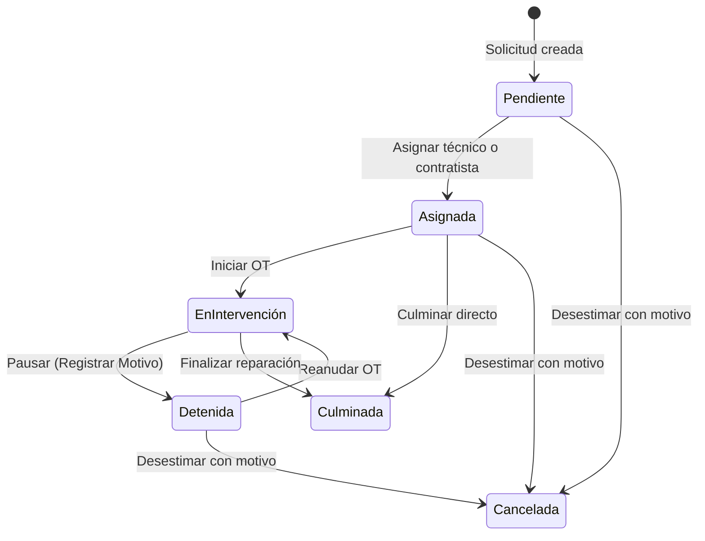

# Manual de Usuario y Administración: CMMS Mantenimiento Industrial v2.4

Este documento describe detalladamente los procedimientos de operación, gestión y administración del **Sistema de Gestión de Mantenimiento Asistido por Computadora (CMMS)** de la planta industrial.

---

## 📑 Tabla de Contenidos

1. [Introducción y Acceso al Sistema](#1-introducción-y-acceso-al-sistema)
2. [Roles de Acceso y Credenciales de Seguridad](#2-roles-de-acceso-y-credenciales-de-seguridad)
3. [Módulo de Producción (Guía del Solicitante / Operador)](#3-módulo-de-producción-guía-del-solicitante--operador)
   - 3.1 [Reportar una Avería de Equipo (Parada de Máquina)](#31-reportar-una-avería-de-equipo-parada-de-máquina)
   - 3.2 [Crear un Requerimiento de Área (Servicios Generales)](#32-crear-un-requerimiento-de-área-servicios-generales)
   - 3.3 [Monitoreo y Seguimiento de Tickets](#33-monitoreo-y-seguimiento-de-tickets)
4. [Módulo de Mantenimiento (Guía de Técnicos y Supervisores)](#4-módulo-de-mantenimiento-guía-de-técnicos-y-supervisores)
   - 4.1 [Recepción y Asignación de Órdenes de Trabajo](#41-recepción-y-asignación-de-órdenes-de-trabajo)
   - 4.2 [Flujo de Estados: Iniciar, Pausar y Detener con Motivo](#42-flujo-de-estados-iniciar-pausar-y-detener-con-motivo)
   - 4.3 [Desestimar / Cancelar una Solicitud con Registro de Auditoría](#43-desestimar--cancelar-una-solicitud-con-registro-de-auditoría)
   - 4.4 [Culminación de Órdenes (Cálculo de Downtime y Tiempo de Atención)](#44-culminación-de-órdenes-cálculo-de-downtime-y-tiempo-de-atención)
   - 4.5 [Mantenimiento Preventivo (Frecuencias Bimestrales, Personalizadas y Generación de OTs)](#45-mantenimiento-preventivo)
   - 4.6 [Métricas y Analítica (Disponibilidad 8h/6d, MTBF, MTTR y Reportes)](#46-métricas-y-analítica)
5. [Módulo de Administración (Guía del Administrador)](#5-módulo-de-administración-guía-del-administrador)
   - 5.1 [Gestión de Catálogos Maestros (Áreas, Equipos y Personal)](#51-gestión-de-catálogos-maestros)
   - 5.2 [Ajustes de Planta y Jornada Laboral (8h/día · 6d/semana)](#52-ajustes-de-planta-y-jornada-laboral)
   - 5.3 [Respaldo y Restauración de Datos (JSON)](#53-respaldo-y-restauración-de-datos)
   - 5.4 [Entornos de Trabajo: Modo Demo vs. Modo Real](#54-entornos-de-trabajo-modo-demo-vs-modo-real)
   - 5.5 [Arquitectura en la Nube (GitHub + Render + MongoDB Atlas)](#55-arquitectura-en-la-nube)
6. [Preguntas Frecuentes y Solución de Problemas (FAQ)](#6-preguntas-frecuentes-y-solución-de-problemas-faq)

---

## 1. Introducción y Acceso al Sistema

El sistema es una plataforma web centralizada diseñada para coordinar las operaciones entre el personal de planta (**Producción**) y el departamento técnico (**Mantenimiento**), garantizando trazabilidad total de paradas, confiabilidad de máquinas y control de costos.

* **Acceso Local**: `http://localhost:3000/` (o la IP local del servidor de planta).
* **Acceso en la Nube**: URL personalizada en Render (ej: `https://tu-planta-cmms.onrender.com`).
* **Compatibilidad**: Funciona en computadoras de escritorio, tablets de supervisores y teléfonos móviles de operadores y técnicos.

---

## 2. Roles de Acceso y Credenciales de Seguridad

La barra superior de navegación permite cambiar entre los 3 entornos principales del sistema:

| Módulo | Público Objetivo | Nivel de Seguridad | PIN por Defecto |
|---|---|---|---|
| **🏭 Producción** | Operadores, maquinistas, supervisores de línea | Acceso Libre | Sin clave |
| **🛠️ Mantenimiento** | Técnicos mecánicos, electricistas, jefatura técnica | PIN Numérico | **`1234`** |
| **⚙️ Administrador** | Jefatura de planta, administradores del sistema | PIN Numérico Maestro | **`9999`** |

> [!NOTE]
> Una vez ingresado el PIN correcto en tu navegador, la sesión queda activa temporalmente para comodidad operativa. Los PINes pueden cambiarse en cualquier momento desde el panel de Administrador.

---

## 3. Módulo de Producción (Guía del Solicitante / Operador)

El personal operativo utiliza este módulo para emitir alertas y solicitudes cuando se presenta una falla o cuando su área requiere una mejora o servicio.

```
       [ OPERADOR EN PLANTA ]
                 │
                 ├──► Opción A: ¿Se detuvo una máquina o falló un equipo? ────► [ Reportar Avería ]
                 │
                 └──► Opción B: ¿Es un servicio de área (luz, fontanería, etc.)? ─► [ Requerimiento ]
```

### 3.1 Reportar una Avería de Equipo (Parada de Máquina)
Utilice este procedimiento cuando una máquina del proceso productivo presente fallas, ruidos anormales, defectos de calidad o se detenga:

1. Haga clic en el botón superior **`➕ Reportar Avería`**.
2. Complete los campos obligatorios del formulario:
   * **Nombre del Solicitante**: Su nombre y cargo (ej: *Marcos Rivas - Operador Línea 1*).
   * **Turno**: Mañana, Tarde, Noche o Rotativo.
   * **Área de Producción**: Seleccione el área donde se ubica la máquina.
   * **Equipo / Máquina**: Al seleccionar el área, el sistema filtrará únicamente las máquinas de esa zona. Escoja el equipo afectado.
   * **Tipo de Falla**: Mecánica, Eléctrica, Neumática, Hidráulica, Electrónica/PLC u Operativa.
   * **Criticidad**:
     * 🔴 **Alta / Crítica**: Línea completamente parada o riesgo inminente.
     * 🟡 **Media**: Máquina funcionando con dificultad o merma de velocidad.
     * 🟢 **Baja**: Defecto menor que no impide la producción inmediata.
   * **Descripción de la Avería**: Explique detalladamente el síntoma observado (ej: *"Atascamiento recurrente en la estrella dosificadora con vibración inusual y ruido metálico"*).
3. Presione **`Enviar Solicitud a Mantenimiento`**.
   * Se generará un número de folio correlativo único (ej: `SOL-015`).
   * La orden aparecerá inmediatamente en la pantalla con estado **`Pendiente`** y un cronómetro de espera en vivo.

### 3.2 Crear un Requerimiento de Área (Servicios Generales)
Utilice este procedimiento para solicitudes que **NO corresponden a paradas mecánicas de maquinaria productiva** (ej: luminarias quemadas, pintura, reparación de una fuga de agua en sanitarios, fabricación de una mesa de trabajo):

1. Haga clic en el botón **`📋 Requerimiento de Área`**.
2. Complete la información requerida:
   * **Solicitante y Turno**.
   * **Área que solicita el servicio**.
   * **Categoría**: Infraestructura, Servicios Generales, Electricidad Edilicia, etc.
   * **Descripción del requerimiento**.
3. Presione **`Registrar Requerimiento`**.
   * *Ventaja de confiabilidad*: Este ticket **NO penaliza la disponibilidad mecánica de las máquinas de producción ni cuenta como horas de parada (downtime)**; se contabiliza de forma separada como tiempo de servicio y atención.

### 3.3 Monitoreo y Seguimiento de Tickets
En la tabla de Producción, los operadores pueden ver:
* **Estado en vivo**:
  * 🟡 **Pendiente**: Esperando asignación por el supervisor técnico.
  * 🔵 **Asignada**: Técnico asignado y en camino.
  * 🟣 **En Intervención**: El técnico está ejecutando la reparación en el sitio.
  * 🟠 **Detenida**: Parada en pausa (ej: esperando compra de un repuesto).
  * 🟢 **Culminada**: Trabajo finalizado y equipo entregado operativo.
* **Tiempo transcurrido**: Muestra los minutos acumulados de espera o intervención.

---

## 4. Módulo de Mantenimiento (Guía de Técnicos y Supervisores)

> **Ingreso**: Seleccionar la pestaña **Mantenimiento** e introducir el PIN **`1234`**.

### 4.1 Recepción y Asignación de Órdenes de Trabajo
Cuando ingresa una orden en estado `Pendiente`, el supervisor o técnico líder debe asignarla:

1. En la lista de Órdenes de Trabajo, localice el ticket pendiente y haga clic en **`👤 Asignar`**.
2. Seleccione el **Tipo de Ejecutor**:
   * **Técnico Interno**: Escoja el técnico de la plantilla de mantenimiento (ej: *Juan Pérez - Mecánico*).
   * **Contratista Externo**: Si el trabajo requiere un taller externo o especialista, ingrese el nombre de la empresa contratista, número de Orden de Compra (OC) y costo cotizado/estimado.
3. Presione **`Guardar Asignación`**. El estado cambiará a **`Asignada`**.

---

### 4.2 Flujo de Estados: Iniciar, Pausar y Detener con Motivo



#### A. Iniciar la Intervención
Al llegar al equipo y comenzar a trabajar:
* Haga clic en **`⚙️ Iniciar OT`**.
* El estado pasará a **`En Intervención`** y el sistema fijará la fecha y hora de inicio de trabajos para el cómputo de tiempos.

#### B. Pausar / Detener una Orden de Trabajo (con motivo)
Si la reparación debe suspenderse temporalmente:
1. Haga clic en el botón de pausa **`⏸️ Detener / Pausar`**.
2. Seleccione el motivo de la detención en el modal:
   * 🛒 **Compra / Espera de Materiales y Repuestos**.
   * 🏭 **Coordinación / Espera de Programación con Producción**.
   * 📋 **Espera de Aprobación Gerencial o Cotización**.
   * ⚠️ **Condiciones Operativas o de Seguridad**.
3. Ingrese una breve observación y confirme.
4. El estado cambiará a **`Detenida`** con una insignia ámbar que refleja el motivo exacto, notificando a todos en planta por qué no se está interviniendo.

#### C. Reanudar la Orden
Cuando el repuesto o la autorización esté disponible:
* Haga clic en **`▶️ Reanudar OT`**. El estado vuelve a **`En Intervención`**.

---

### 4.3 Desestimar / Cancelar una Solicitud con Registro de Auditoría
Si una solicitud fue emitida por error, es un reporte duplicado, o resulta inviable técnicamente:

1. En la fila de la solicitud, presione el botón rojo **`🗑️ Desestimar`**.
2. El sistema abrirá un cuadro para registrar el **Motivo de Cancelación**:
   * Ej: *"Reporte duplicado con la orden SOL-012"* o *"Falsa alarma, sensor requería limpieza realizada por operador"*.
3. **Comportamiento del sistema**:
   * La orden pasa al estado **`Cancelada`**.
   * **No se borra**: Queda archivada para auditoría histórica con el motivo justificado.
   * **No penaliza las métricas**: Automáticamente **deja de contar como orden abierta o pendiente** en los contadores y no penaliza la tasa de resolución de mantenimiento.

---

### 4.4 Culminación de Órdenes (Cálculo de Downtime y Tiempo de Atención)

Al finalizar la intervención técnica, presione **`✅ Culminar`**:

1. El modal se adapta automáticamente según el tipo de orden:
   * **Si es Avería de Equipo**:
     * Calcula el **Tiempo Total de Parada de Máquina (Downtime)** entre la fecha de inicio/solicitud y la fecha de culminación.
     * Utilice el botón **`Ahora`** para fijar la hora actual exacta.
     * Ingrese el **Diagnóstico Técnico** (causa raíz del problema).
     * Ingrese la **Solución Aplicada** (acciones realizadas).
     * Ingrese los **Repuestos y Materiales Utilizados** (con códigos de parte si aplica).
   * **Si es Requerimiento de Área**:
     * Calcula el **Tiempo de Atención del Requerimiento**.
     * Puede presionar **`[Fecha Solicitud]`** si desea computar el tiempo desde que el área emitió la solicitud.
2. Haga clic en **`Guardar y Culminar`**.
   * El equipo vuelve a estado **Operativo**.
   * Los minutos de parada impactan en las métricas de MTTR y Disponibilidad Mecánica.

---

### 4.5 Mantenimiento Preventivo

En la sección **Planes Preventivos**, el departamento planifica rutinas periódicas para evitar averías:

#### A. Crear un Plan Preventivo
1. Presione **`📅 Registrar Plan Preventivo`**.
2. Ingrese:
   * **Código del Plan** (ej: `MP-ENV-01`).
   * **Frecuencia de Ejecución**:
     * Semanal (7 días)
     * Quincenal (15 días)
     * Mensual (30 días)
     * **Bimestral (cada 60 días)**
     * Trimestral (90 días)
     * Semestral (180 días)
     * Anual (365 días)
     * **⚙️ Personalizado (según equipo)**: Permite ingresar el número exacto de días (ej: 45 días para engrase de rodamientos de alta velocidad, 120 días para calibración de balanzas).
   * **Próxima Fecha**: Al escoger la frecuencia o escribir los días personalizados, el sistema calcula automáticamente la fecha sugerida (`Fecha actual + Días`).
   * **Checklist de Tareas**: Escriba una tarea por línea (ej: *1. Verificar nivel de aceite, 2. Tensar cadena, 3. Limpiar filtro*).
   * **Tipo de Ejecutor y Costo Estimado**.
3. Guarde el plan.

#### B. Generar una Orden de Trabajo Inmediata desde el Preventivo
Cuando llegue la fecha o se decida ejecutar la rutina:
* Haga clic en el botón verde **`🚀 OT`** en la fila del preventivo.
* El sistema:
  1. Crea automáticamente una nueva Orden de Trabajo clasificada como **`📅 Preventivo Programado`** (claramente diferenciada de las averías o fallas imprevistas), con su checklist detallado listo para inspección.
  2. Asigna automáticamente al técnico o contratista configurado en el plan.
  3. **Reprograma automáticamente la siguiente fecha del preventivo** sumando el ciclo configurado (`+60` días si es bimestral, o el intervalo personalizado).
  4. Registra la fecha de ejecución y suma el contador histórico de veces ejecutado (`Nx`).
  5. **Protección de Confiabilidad y Disponibilidad**: Como es un trabajo preventivo planificado, **NO se contabiliza como avería imprevista** ni penaliza el MTBF ni las horas de parada por falla de planta. En las bandejas operativas y filtros se identifica con la etiqueta morada **`📅 Preventivo`**.

#### C. Búsqueda y Filtrado de Planes Preventivos
En la parte superior del módulo preventivo se dispone de una barra de búsqueda y filtros interactivos en tiempo real:
* **Buscador Universal**: Escriba cualquier palabra clave para filtrar al instante por código de plan, título, equipo, área, tareas del checklist o nombre del técnico.
* **Filtro de Estado y Ejecución**:
  * **Todos los Estados**: Vista general de todos los planes.
  * **🟢 Al Día**: Muestra los planes vigentes que no tienen retrasos programados.
  * **✅ Ejecutados**: Filtra los planes que ya cuentan con un historial de ejecución registrada.
  * **⏳ No Ejecutados**: Filtra los planes que aún no se han ejecutado (pendientes de primera ejecución).
  * **🟡 Próximos a Vencer**: Planes que deben ejecutarse en los próximos 5 días.
  * **🔴 Vencidos**: Planes cuya fecha ya expiró sin haberse generado la OT.
* **Filtros Adicionales por Área y Frecuencia**: Para aislar planes por línea de producción o por ciclo (Semanal, Quincenal, Mensual, Bimestral 60d, etc.).
* **Filtro Rápido desde Tarjetas KPI**: Al hacer clic sobre cualquiera de las tarjetas superiores (*Total*, *Al Día*, *Próximos*, *Vencidos*), la tabla aplica el filtro automáticamente con un solo clic.

---

### 4.6 Métricas y Analítica

El panel de **Métricas (KPIs)** permite evaluar el desempeño técnico e industrial:

```
[ TARJETAS DE INDICADORES CLAVE ]
┌────────────────────────┐  ┌────────────────────────┐  ┌────────────────────────┐
│  Disponibilidad Mec.   │  │ Tiempo Parada Averías  │  │ Atención Requerimientos│
│        98.5%           │  │        2h 30m          │  │        4h 15m          │
│ (8h/día · 6d/semana)   │  │ (2.5 hrs en averías)   │  │ (3 servicios de área)  │
└────────────────────────┘  └────────────────────────┘  └────────────────────────┘
┌────────────────────────┐  ┌────────────────────────┐  ┌────────────────────────┐
│   MTTR (Tiempo Rep.)   │  │   MTBF (Entre Fallas)  │  │   Tasa de Resolución   │
│        1.25 hrs        │  │       190.5 hrs        │  │         100%           │
└────────────────────────┘  └────────────────────────┘  └────────────────────────┘
```

* **Disponibilidad Mecánica de Planta**: Evalúa el tiempo neto de trabajo contra las horas planificadas bajo el régimen de **8 horas diarias y 6 días laborales a la semana** (48h/semana por máquina).
* **MTTR (Mean Time To Repair)**: Promedio de horas que toma reparar una máquina cuando falla.
* **MTBF (Mean Time Between Failures)**: Horas promedio de operación continua de las máquinas entre una avería y la siguiente.
* **Tabla de Confiabilidad por Equipo**: Permite ver qué máquinas específicas tienen menor disponibilidad (🟢 $\ge 95\%$, 🟡 $85-94.9\%$, 🔴 $< 85\%$).
* **Botón `📥 Exportar Informe a CSV / Excel`**: Descarga una planilla completa con cabeceras de gestión, fechas, técnicos y horas para reportes gerenciales.

---

## 5. Módulo de Administración (Guía del Administrador)

> **Ingreso**: Seleccionar la pestaña **Administrador** e introducir el PIN Maestro **`9999`**.

### 5.1 Gestión de Catálogos Maestros

El administrador es el único autorizado para crear, editar o dar de baja:
* **Áreas de Planta**: Definir códigos y nombres (ej: *ENV - Línea de Envasado*).
* **Equipos e Instalaciones**: Registrar maquinaria, código de activo, área a la que pertenece y criticidad.
* **Personal / Empleados**: Registrar técnicos, supervisores y operadores con su especialidad y teléfono.

---

### 5.2 Ajustes de Planta y Jornada Laboral

En el **Panel 5.4: Ajustes Generales del CMMS**:
* **Nombre de la Empresa o Planta**: Se muestra en las cabeceras e informes impresos.
* **Símbolo de Moneda**: Para presupuestos y órdenes de contratistas (ej: `$`, `Bs`, `€`).
* **Horas Operativas Diarias (Turno)**: Configurado por defecto en **`8`** horas.
* **Días Laborales por Semana**: Configurado por defecto en **`6`** días.
* **Cambio de PIN de Mantenimiento**: Actualizar la clave de 4 dígitos para técnicos.
* **Cambio de PIN de Administrador**: Actualizar la clave maestra.

> [!TIP]
> Si la fábrica pasa temporalmente a 2 turnos de producción (16 horas) o a trabajar 5 días a la semana, basta con cambiar estos dos campos y presionar **`Guardar Configuración`**; todas las métricas de disponibilidad y MTBF se actualizarán automáticamente.

---

### 5.3 Respaldo y Restauración de Datos

En el **Panel 5.5: Respaldo y Datos**:
* **`📥 Descargar Respaldo JSON`**: Descarga en su computadora una copia de seguridad íntegra de toda la base de datos (equipos, historial de averías, preventivos y configuraciones).
* **`📤 Cargar Respaldo JSON`**: Permite restaurar el sistema a un punto anterior en caso de migración o reemplazo de servidor.

---

### 5.4 Entornos de Trabajo: Modo Demo vs. Modo Real

El sistema cuenta con un selector de entorno en el menú de administrador:
* **Modo Demostración (`demo`)**: Carga datos ficticios de ejemplo (líneas de envasado, calderas, técnicos de prueba) para capacitar al personal sin alterar los datos reales de la fábrica.
* **Modo Entorno Real (`real`)**: Trabaja con la base de datos oficial y limpia de la planta.
* **Botón `Reiniciar Demostración`**: Restablece los datos de prueba a sus valores iniciales si se desea practicar nuevamente.

---

### 5.5 Arquitectura en la Nube

Para garantizar que el sistema funcione 24/7 sin pérdida de información:

```
[ Cambios de Código ] ──► GitHub ──► Render (Servidor Web)
                                          │
                               ( Lee / Escribe Datos en Vivo )
                                          ▼
                                   MongoDB Atlas
                              (Base de Datos Permanente)
```

1. **GitHub**: Aloja los archivos de código fuente.
2. **Render**: Aloja y corre el servidor Node.js. Al recibir un nuevo *commit* desde GitHub, se actualiza solo en 1 minuto.
3. **MongoDB Atlas**: Es la base de datos en la nube. **Todas las órdenes de trabajo, equipos y preventivos se almacenan permanentemente en MongoDB Atlas**, garantizando que ningún dato se borre al actualizar el código o reiniciar el servidor.

---

## 6. Preguntas Frecuentes y Solución de Problemas (FAQ)

### ¿Qué hago si olvidé el PIN de Mantenimiento o Administrador?
* Los PINes originales por defecto son `1234` para Mantenimiento y `9999` para Administrador. Si fueron cambiados, el Administrador puede verificarlos o editarlos en el archivo de base de datos o solicitar la restauración técnica.

### ¿Por qué una solicitud cancelada no aparece como pendiente?
* El sistema fue diseñado para archivar las órdenes desestimadas como registros históricos con su motivo de rechazo justificado, pero excluyéndolas deliberadamente de la lista de pendientes para no distorsionar la carga de trabajo real del equipo técnico.

### ¿Cómo se calculan las horas en el Mantenimiento Preventivo Bimestral?
* Al escoger la frecuencia **Bimestral**, el sistema fija automáticamente un ciclo de **60 días exactos**. Al generar la OT, la próxima fecha se reprograma para dentro de 60 días a partir de la ejecución.

### ¿Se pierden los datos si se apaga el servidor local o se reinicia Render?
* **No**. En local, los datos se guardan inmediatamente en archivos JSON persistentes en la carpeta `data/`. En la nube (Render), los datos se escriben directamente en el clúster de **MongoDB Atlas**, permaneciendo seguros e intactos.
